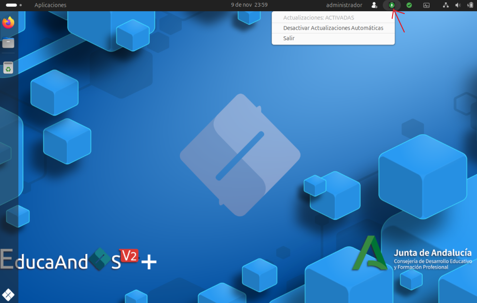
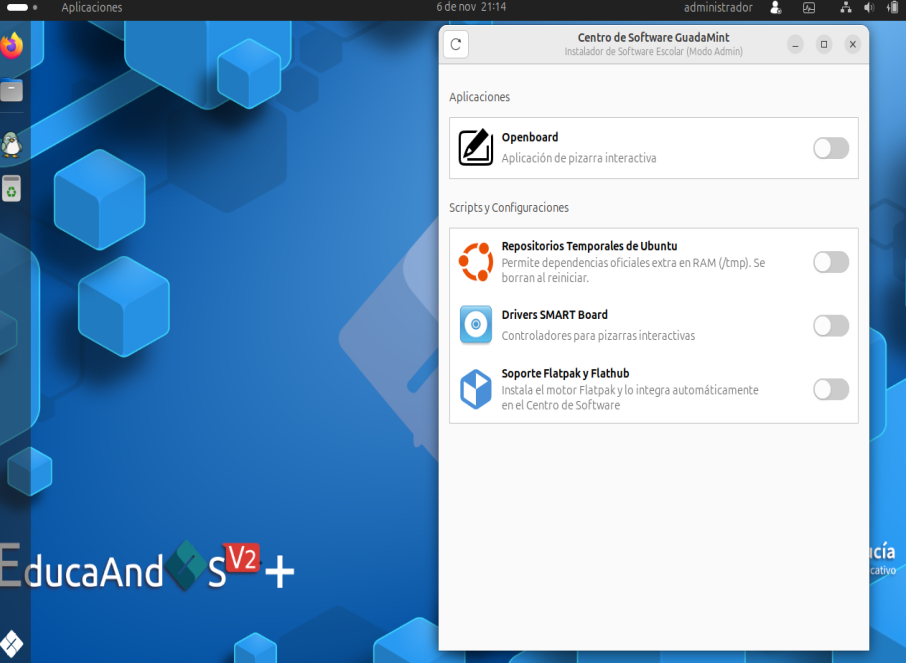

# EducaAndOS v2 Plus

## [Enlace 10/11/26](http://) 

Versión optimizada y basada en la distribución oficial [**EducaAndOS v2**](http://www.juntadeandalucia.es/educacion/cga/portal/?page_id=7886), pensada para facilitar el despliegue y el mantenimiento de los equipos del centro.

---

## 📌 Características Principales

* **Base Oficial:** Desarrollado sobre **EducaAndOS v2 oficial**, manteniendo toda su compatibilidad y herramientas educativas.
* **Instalación Sencilla y Dual Boot:** Mismo proceso de instalación que la versión oficial, con detección e integración automática de **Windows** para arranque dual.
* **Gestión de Usuarios:**
  * **`usuario`**: Cuenta estándar de uso diario sin permisos `sudo`.
  * **`administrador`**: Cuenta de administración del sistema con derechos **sudo** (contraseña: `root`).
  * **`usuario IdEA`**: igual que el sistema oficial, la wifi se carga con vuestra cuenta idea y además no la borra en cada inicio. Puedes manterner la wifi **Andared Corporativo** en los usuario locales.
---

## ⚡ Aplicaciones y mejoras integradas

### 1. Deshabilitador auto actualizaciones del sistema oficial.
Si algún paquete corrompe el sistema en los centros o no quieres actualizar a una version actual, pulsa en la flecha verde de la esquina superior derecha y las actualizaciones oficiales estarán deshabilitadas para siempre.

### 2. Cuenta administrador con derechos sudo.
Entra con esta cuenta y haz con el sistema lo que quieras, como debe ser, como cualquier distribución linux.

### 3. Auto-Actualizador propio al Inicio (`update-guadamint`)
Una aplicación se ejecuta automáticamente al arrancar el equipo para mantener el sistema al día de forma transparente. 

### 4. Deshabilitación de la suspensión de la pantalla
Cada poco rato se activa la suspensión de la pantalla e incluso se sale de la sesión. Deshabilitado como en los paneles.

### 5. Gestor de Scripts y Configuraciones (`apps-guadamint`)
Herramienta centralizada para aplicar ajustes del sistema e instalar utilidades necesarias en el aula.

#### 📋 Contenido actual de `apps-guadamint`:
* **Actualización del sistema:** Mantenimiento y descarga de parches automáticos, nuevas funciones y aplicaciones añadidas apareceran al iniciar automáticamente en tu sistema.
* **Ejecución de scripts de configuración:** Aplicaciones o scripts para [drivers de pizarras](/images/eosv2-smarboard.png), navegadores, aplicaciones no incluidas en el sistema oficial y añade al sistema compatibilidad en el sistema de instalaciones flatpak. 
* **Reparación de paquetes:** Resolución y corrección automática de dependencias locales.
* **Personalización de entorno:** Despliegue de accesos directos y configuraciones de aula.

---

## 🚀 Instalación con Ventoy

Esta versión está optimizada para ser iniciada directamente desde un pendrive preparado con **Ventoy**, sin necesidad de formatear o "quemar" la ISO cada vez. Por ahora no funciona con ETCHER o Creador de USB de ubuntu o educaandos.

### 🔗 Enlaces Útiles
* **Sitio oficial de Ventoy:** [ventoy.net](https://www.ventoy.net)
* **Descargar Ventoy:** [Sección de descargas de Ventoy](https://www.ventoy.net/en/download.html)
* **Repositorio de GitHub:** [Ventoy en GitHub](https://github.com/ventoy/Ventoy)

---

